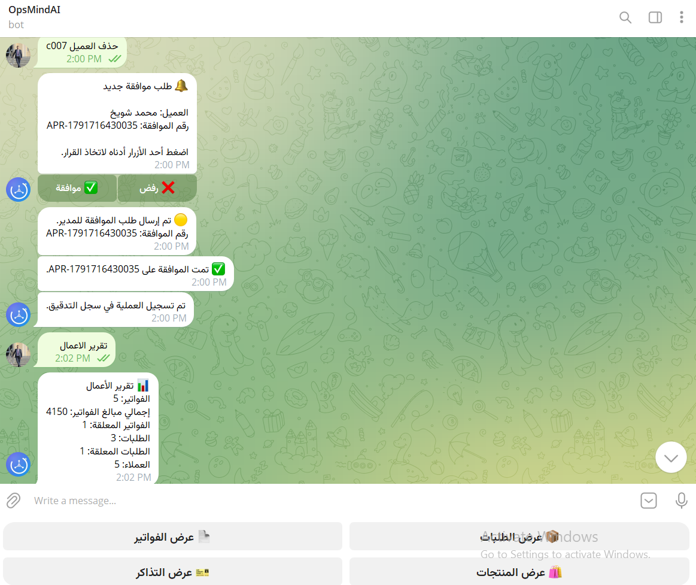
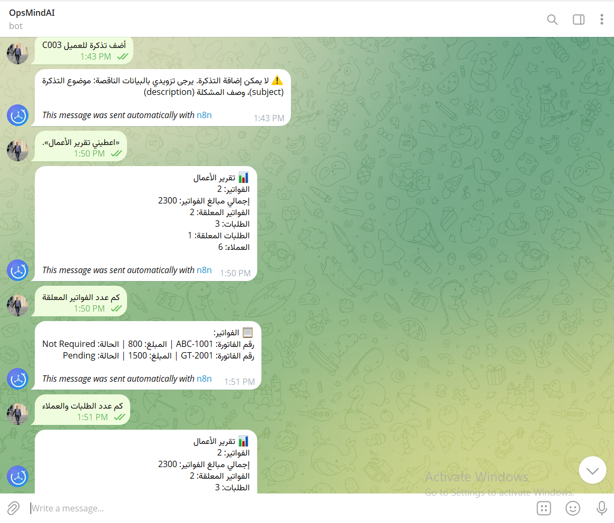
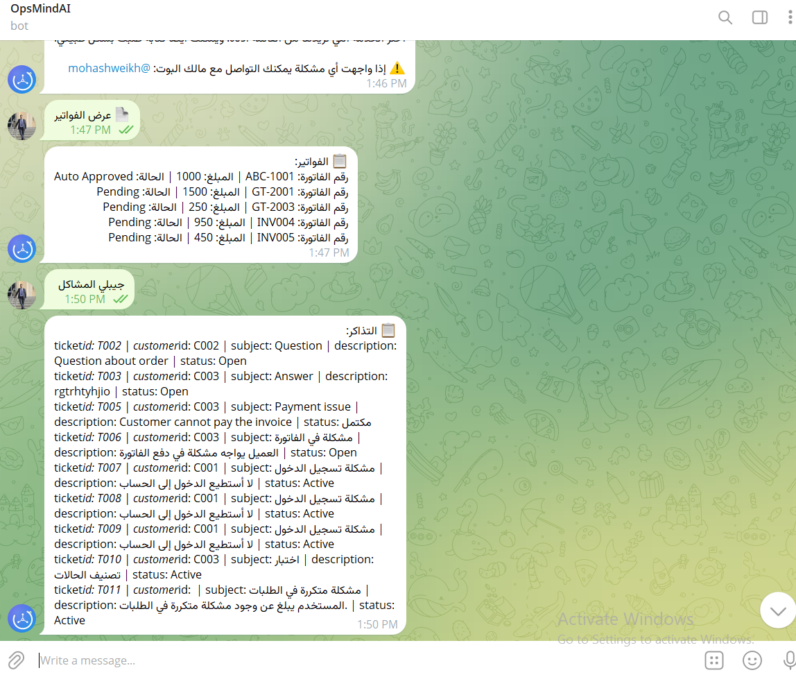

<p align="center"></p>

# OpsMind AI

Telegram-based AI operations assistant built with **n8n + Google Gemini + Google Sheets + Gmail**.
Employees write requests in Arabic or English; an AI agent extracts the intent, role rules gate the action, and dedicated workflows handle invoices, customers, orders, tickets, reports and approvals — with full audit logging and a global error handler.

> 🎥 **Demo video:** _add link here_

## Screenshots

| Approval flow (WF-02) | Missing-data validation + report |
|---|---|
|  |  |

| Invoices & tickets via natural language |
|---|
|  |

## Architecture

```
Telegram → user lookup (Users sheet) → authorization gate → AI intent parsing
        → role gate → router → WF-01..06 → WF-08 audit → Telegram reply

Schedule (09:30)         → WF-06 report → Gemini summary → Telegram   (WF-07)
Any workflow error       → WF-09 → Telegram alert + audit log
Invoice > 1000 / delete  → WF-02 → manager approves/rejects via inline buttons
```

| Workflow | Role |
|---|---|
| WF-00 Telegram Router | Entry point, authorization, AI agent, routing |
| WF-01 Invoice Processing | Invoices |
| WF-02 Approval Management | Human approval (invoice > 1000, deletions) |
| WF-03 Customer Management | Customers (duplicate check) |
| WF-04 Order Management | Orders |
| WF-05 Support Tickets | Tickets |
| WF-06 Business Reports | On-demand report |
| WF-07 Daily AI Report | Scheduled AI summary |
| WF-08 Audit Logging | Every operation → AuditLog |
| WF-09 Error Handler | Alert + log on any failure |

## Design decisions
- **The model never decides permissions.** Gemini only returns an intent JSON; roles (Manager / Admin / Employee), thresholds and approvals are deterministic rules.
- **Human in the loop** for risky actions; only a Manager can approve.
- **No fake success:** failures go to WF-09, which alerts and logs instead of replying "done".
- Unregistered or inactive Telegram users are rejected before the AI is called.

## Setup
1. Create a Google Sheet with tabs: Users, Customers, Products, Invoices, Orders, Tickets, Approvals, AuditLog. Sample data: [`data/OpsMind_Sample_Data.xlsx`](data/OpsMind_Sample_Data.xlsx) (roles must be exactly `Manager`, `Admin` or `Employee`).
2. Import all files from [`workflows/`](workflows) into n8n and connect your own credentials (Telegram, Google Sheets, Gmail, Gemini).
3. Replace placeholders: `YOUR_MANAGER_CHAT_ID` (WF-02 ×2, WF-07 ×2, WF-09), `manager@example.com`, `@YOUR_USERNAME`.
4. Re-link the "Call WF-xx" sub-workflow nodes, and set WF-09 as the Error Workflow in each workflow's settings.
5. Put your Telegram ID in Users as Manager (status `active`), then activate all workflows.

No secrets are included; credentials are placeholders only.

## Known limitations
- Invoices added through WF-01 do not yet pass through the approval/audit path on the add route.
- Requires a running n8n instance; the bot is not hosted publicly.

## Presentation
Arabic project presentation: [`assets/OpsMind_AI_Presentation_AR.pdf`](assets/OpsMind_AI_Presentation_AR.pdf)

## Author
Mohammed Al-Shweikh · [GitHub](https://github.com/Mohmmed-AlShweikh) · [LinkedIn](https://linkedin.com/in/mohashweikh1)

## License
MIT
